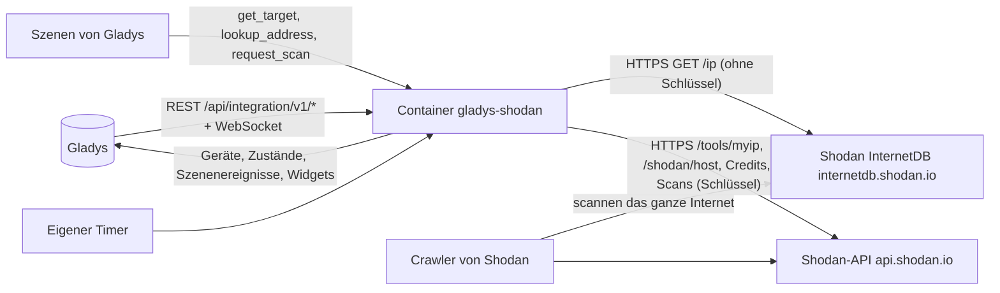
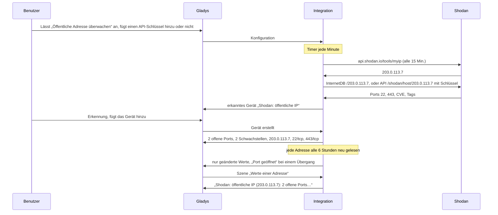
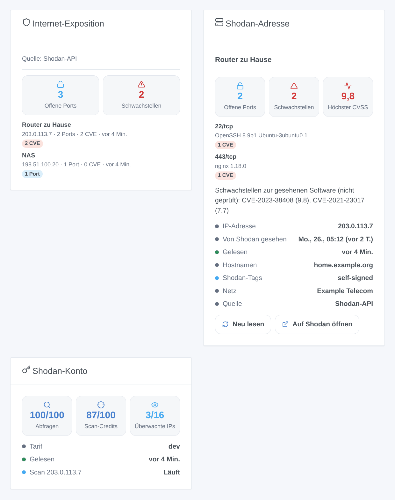

# Gladys Shodan

[English](README.md) · [Français](README.fr.md) · **Deutsch** · [Español](README.es.md)

[](LICENSE)
[](https://github.com/William-De71/gladys-shodan/releases)
[](https://github.com/William-De71/gladys-shodan/actions/workflows/release.yml)
[](https://gladysassistant.com)


Externe Integration von [Gladys Assistant](https://gladysassistant.com) für **Shodan**: Sie zeigt in Gladys, was das Internet von deinem Zuhause sieht, so wie Shodan es kennt — die offenen Ports, die Schwachstellen (CVE), die der von Shodan gesehenen Software zugeordnet sind, seine Tags — und löst Szenen aus, wenn ein Port aufgeht, eine Schwachstelle erscheint oder die öffentliche Adresse wechselt. Shodan scannt das ganze Internet; die Integration **fragt** Shodan nur, was es über die überwachten Adressen weiß, sie scannt nie etwas von Gladys aus. Ohne Schlüssel nutzt sie die kostenlose [Shodan InternetDB](https://internetdb.shodan.io); mit dem optionalen API-Schlüssel eines Shodan-Kontos liefert die [Shodan-API](https://developer.shodan.io/api) zusätzlich die Softwareversionen, die CVSS-Werte und das Datum des letzten Scans — nur lesend.

Benutzerdokumentation: [English](docs/en.md) · [Français](docs/fr.md) · [Deutsch](docs/de.md) · [Español](docs/es.md).

Nicht mit Shodan verbunden. Nur die überwachten Adressen werden an Shodan gesendet. Überwache nur eigene Adressen.

## Funktionen

- Die **öffentliche Adresse des Zuhauses** (die Adresse, die der Router nutzt), alle 15 Minuten bei Shodan abgefragt und bei einem Wechsel verfolgt, dazu bis zu **10 weitere Adressen** (öffentliche IP-Adressen oder Hostnamen: ein DynDNS-Name, ein Server).
- **Ein Gerät pro überwachter Adresse**: Anzahl offener Ports, Anzahl Schwachstellen, die gelesene Adresse und die Liste der Ports.
- **7 Szenenauslöser** (Port geöffnet, Port geschlossen, Schwachstelle gefunden, Schwachstelle verschwunden, neuer Tag, öffentliche IP geändert, API-Schlüssel abgelehnt), **3 Szenenaktionen** (Werte einer Adresse, Adresse nachschlagen, Adresse scannen) und **3 Dashboard-Widgets** (Internet-Exposition, Shodan-Adresse, Shodan-Konto).
- **Zwei Quellen**: Shodan InternetDB ohne Schlüssel (kostenlos für nicht-kommerzielle Nutzung, ohne Konto); die Shodan-API mit Schlüssel (Software und Version pro Dienst, CVSS-Wert und Beschreibung jeder CVE, Datum, an dem Shodan die Adresse zuletzt gesehen hat, Organisation, Credits, Scan auf Anfrage mit einem kostenpflichtigen Tarif).
- **Nur lesend**: Die Integration stellt Fragen, sie ändert nichts im Shodan-Konto und scannt selbst nichts. Der API-Schlüssel wird nie nach `/data` geschrieben.
- Überall vier Sprachen: Englisch, Französisch, Deutsch, Spanisch.

## Funktionsweise




Von der Konfiguration zur Szene:



### Transport

`transports: ["cloud"]`: Die Daten kommen von `internetdb.shodan.io` und `api.shodan.io`. **Nur die überwachten Adressen verlassen dein Netzwerk** (und der API-Schlüssel, nur an `api.shodan.io`, wenn du einen angibst); was Shodan über sie weiß, stammt aus seinen eigenen Scans des Internets. Hostnamen werden vom DNS des Containers aufgelöst. `/data/shodan.json` (Modus 0600) behält die letzten Abfragen, was die Auslöser wissen, die Credits und die angeforderten Scans — nie den API-Schlüssel.

## Geräte und Funktionen

| Gerät                                                                                           | Funktionen (Kategorie / Typ)                                                                                                                                  |
| ----------------------------------------------------------------------------------------------- | ------------------------------------------------------------------------------------------------------------------------------------------------------------- |
| „Shodan: öffentliche IP“ für die öffentliche Adresse, „Shodan &lt;Adresse&gt;“ für jede weitere | Offene Ports (`counter-sensor` / `integer`), Schwachstellen (`counter-sensor` / `integer`), IP-Adresse (`text` / `text`), erreichbare Ports (`text` / `text`) |

- Die Geräte werden im Erkennungsbildschirm angeboten: Du fügst die gewünschten hinzu.
- „Shodan: öffentliche IP“ bleibt dasselbe Gerät, wenn die öffentliche Adresse wechselt; die Funktion IP-Adresse zeigt die gelesene Adresse.
- Schwachstellen sind die CVE, die Shodan der gesehenen Software anhand ihrer Versionen zugeordnet hat: Sie sind auf dem Gerät **nicht geprüft**.
- Erreichbare Ports lauten „22/tcp, 443/tcp“ mit Schlüssel, „22, 443“ ohne (InternetDB liefert kein Transportprotokoll).
- Alle Funktionen sind nur lesend und behalten ihren Verlauf: „Schwachstellen > 0“ ist eine Gerätebedingung von Gladys.
- External IDs: `ext:…:target:public` für die öffentliche Adresse, `ext:…:target:<Adresse>` für die anderen.

## Szenenauslöser, Aktionen und Widgets



**Widgets**:

- **Internet-Exposition**: Kacheln mit der Summe der offenen Ports und Schwachstellen, dann eine Karte pro Adresse, die bedenklichste zuerst (Alarm-Tags compromised / malware / doublepulsar, dann CVE, dann Fehler, dann offene Ports), jede mit ihren Ports, CVE, Tags und einem Link zu ihrer Seite auf shodan.io; eine Legende nennt die Quelle.
- **Shodan-Adresse**: eine Adresse (Einstellung: ein Gerät; leer = die öffentliche Adresse): Kacheln Ports, Schwachstellen und höchster CVSS-Wert (mit Schlüssel), eine Karte pro Port / Dienst mit Produkt, Version und CVE (Werte und Beschreibungen), ein Text mit den CVE, Statuszeilen (IP, zuletzt von Shodan gesehen, gelesen, Hostnamen, Tags, Netzwerk, Quelle), eine Schaltfläche **Neu lesen** (höchstens einmal pro Minute) und eine Schaltfläche **Auf Shodan öffnen**.
- **Shodan-Konto**: Abfrage-Credits, Scan-Credits und überwachte IPs gegenüber ihren Grenzen, der Tarif, die letzten Scans; ohne Schlüssel sagt es, dass ein Schlüssel nötig ist.

**Auslöser** (ein Ereignis pro Übergang, nie bei der ersten Abfrage, nie als Folge einer Szenenaktion; höchstens 10 Ereignisse einer Art pro Adresse und Abfrage):

- **Port geöffnet** / **Port geschlossen** (Filter: Adresse, Portnummer; Variablen: Ziel, Name des Ziels, IP, Ports, Port sowie Transport und Produkt mit Schlüssel);
- **Schwachstelle gefunden** (Filter: Adresse; Variablen: CVE, CVSS-Wert und Zusammenfassung mit Schlüssel, `url` = ihre NVD-Seite) / **Schwachstelle verschwunden** (CVE, `url`);
- **neuer Tag** (Filter: Adresse, Tags: compromised, malware, honeypot, doublepulsar, eol-product, eol-os, self-signed, starttls, database, devops, iot, ics, medical, videogame, vpn, proxy, tor, cdn, cloud, scanner; Variable: Tag);
- **öffentliche IP geändert** (Variablen: vorige IP, IP; alle 15 Minuten geprüft);
- **API-Schlüssel abgelehnt** (Grund `refused` und eine Meldung), einmal pro Ablehnung; ein Tarif, der Host-Abfragen ablehnt (HTTP 403), löst ihn nicht aus.

Eine neue Adresse oder ein Wechsel der Quelle (Schlüssel hinzugefügt oder entfernt) beginnt eine neue Basis ohne Ereignisse: Was Shodan über eine frisch vergebene Adresse weiß, kann ihren vorigen Inhaber beschreiben.

**Aktionen**:

- **Werte einer Adresse**: aus der letzten Abfrage, ohne Anfrage (Feld: ein Adressgerät, leer = die öffentliche Adresse oder die erste); Ausgaben: Name des Ziels, IP, Anzahl Ports, Ports, Anzahl Schwachstellen, Schwachstellen, höchster CVSS-Wert, Tags, Hostnamen, Quelle (`internetdb` oder `api`), letzter Scan (ISO 8601, mit Schlüssel), Zeitpunkt der Abfrage und ein Satz (`summary`), zum Beispiel „Shodan: öffentliche IP (203.0.113.7): 2 offene Ports (22/tcp, 443/tcp), 2 Schwachstellen (CVSS 9.8). Shodan-Tags: self-signed.“;
- **Adresse nachschlagen**: jede öffentliche IP oder jeder Hostname, sofort eine Anfrage; Ausgaben: IP, gefunden, Anzahl Ports, Ports, Anzahl Schwachstellen, Schwachstellen, höchster CVSS-Wert, Tags, Hostnamen, Quelle, `summary`;
- **Adresse scannen**: bittet Shodan, ein Adressgerät sofort zu scannen (API-Schlüssel und Scan-Credits eines kostenpflichtigen Tarifs, 1 Credit pro Adresse); Ausgaben: Scan-ID, IP, verbleibende Credits. Die Adresse wird neu gelesen, sobald der Scan fertig ist.

Beispiele:

- Wenn **Shodan: Port geöffnet** auf der öffentlichen IP → „Port {{triggerEvent.data.port}} ist auf {{triggerEvent.data.ip}} offen“ senden.
- Wenn **Shodan: Schwachstelle gefunden** → „{{triggerEvent.data.cve}}: {{triggerEvent.data.url}}“ senden.
- Jeden Montag um 8:00 → **Shodan: Werte einer Adresse** → ihr `summary` senden.
- Wenn **Shodan: öffentliche IP geändert** → „Neue öffentliche Adresse: {{triggerEvent.data.ip}}“ senden.

## Voraussetzungen

- Gladys Assistant **5.3.0** oder neuer (Widgets und Szenen der Integrationen): Ältere Instanzen können die Integration nicht installieren.
- Internet: Die Integration spricht nur mit `internetdb.shodan.io` und `api.shodan.io`.
- Optional: ein [Shodan-Konto](https://account.shodan.io) und sein API-Schlüssel. Shodan InternetDB ist nur für nicht-kommerzielle Nutzung kostenlos.

### Das Tempo der API

Shodan bittet um höchstens eine Anfrage pro Sekunde: Die Anfragen gehen im Abstand von 1,1 s raus. Ein Timer prüft jede Minute, was fällig ist: die öffentliche Adresse alle 15 Minuten; jede Adresse alle 6 Stunden oder sofort, wenn sich ihre IP geändert hat; ein neuer Versuch 30 Minuten nach einem Fehler; die Credits alle 6 Stunden; ein angeforderter Scan wird alle 2 Minuten verfolgt, bis er fertig ist, dann wird die Adresse neu gelesen. Ein 429 oder ein Serverfehler pausiert nur diesen Dienst (InternetDB oder die API). Ein abgelehnter Schlüssel (HTTP 401): InternetDB antwortet in der Zwischenzeit, der Auslöser feuert einmal und der Schlüssel wird alle 6 Stunden erneut versucht. Ein Tarif, der Host-Abfragen ablehnt (HTTP 403): InternetDB wird 24 Stunden lang genutzt. Shodan aktualisiert InternetDB etwa einmal pro Woche: Die meisten Abfragen bringen nichts Neues.

## Installation

- **Aus dem Store**: Integrationen → Shodan → Installieren.
- **Über die Repository-URL**: Integrationen → externe Integration → `https://github.com/William-De71/gladys-shodan`.
- **Entwicklermodus**: `npm start` mit den von Gladys gegebenen Variablen ausführen (siehe Entwicklung).

## Konfiguration

| Feld oder Schaltfläche                      | Standard    | Bedeutung                                                                                                                                                      |
| ------------------------------------------- | ----------- | -------------------------------------------------------------------------------------------------------------------------------------------------------------- |
| Öffentliche Adresse des Zuhauses überwachen | an          | Die Adresse, die der Router nutzt, alle 15 Minuten bei Shodan abgefragt; ein Adresswechsel wird verfolgt                                                       |
| Weitere Adressen                            | —           | Öffentliche IP-Adressen oder Hostnamen, durch Kommas getrennt, höchstens 10; private, lokale oder ungültige Einträge werden ignoriert und im Status aufgeführt |
| API-Schlüssel                               | —           | Optional, ein Geheimnis: nie wieder angezeigt, nie geloggt, nie nach `/data` geschrieben                                                                       |
| Sprache der Texte                           | automatisch | Funktionsnamen, Szenentexte und Fehler (automatisch: die Sprache des zuletzt angezeigten Widgets)                                                              |
| Verbindung testen / Diagnose                | —           | Die öffentliche Adresse, jede Adresse und der Schlüssel sofort gelesen; der Zustand in den Logs, nie der Schlüssel                                             |

## Verwendung

1. Optional: Leg ein Shodan-Konto an und kopiere seinen API-Schlüssel von [account.shodan.io](https://account.shodan.io).
2. In Gladys (Integrationen → Shodan → Konfiguration): die öffentliche Adresse überwacht lassen, weitere Adressen hinzufügen, den Schlüssel einfügen; **Verbindung testen** drücken.
3. **Erkennung**, dann die gewünschten Adressen als Geräte hinzufügen.
4. Die Widgets zu einem Dashboard hinzufügen, Szenen mit den Funktionen, Auslösern und Aktionen bauen.

## Entwicklung

```bash
npm install
npm test                       # node --test, ein falsches Shodan (test/helpers/fake-shodan.js), nie das Netzwerk
UPDATE_BASELINE=1 npm test     # schreibt test/fixtures/discovery.baseline.json neu (nur absichtlich)
npm run lint                   # ESLint
npm run format:check           # Prettier
npx github:GladysAssistant/integration-store . --skip-image-check
scripts/build-cover.sh         # cover.jpg aus docs/assets/cover.svg
docs/illustrations/render.sh   # docs/assets/widgets.<sprache>.png
node .github/scripts/release.mjs next   # die Version, die das nächste Release bekäme
```

Lokal liest das SDK `GLADYS_HOST_API_URL`, `GLADYS_INTEGRATION_TOKEN` und `GLADYS_INTEGRATION_SELECTOR` (von Gladys im Entwicklermodus gegeben), und die Integration liest `TZ`. `DEBUG=gladys-integration-sdk` zeigt die Logs des SDK.

Die Tests decken den HTTP-Client ab (InternetDB und die API, abgelehnter Schlüssel und Tarif, die Pausen, der Abstand der Anfragen), die Parser, die Auslöser, die Geräte (die Felder, die der Erkennungsbildschirm verlangt, die Kategorie-/Typ-Paare des Kerns), die Widgets (`validateWidgetContent`), das Manifest, die vier Sprachen, das Release-Skript und die ganze Integration gegen das falsche Gladys des SDK und ein falsches Shodan. `test/structure.test.js` friert jeden Schlüssel ein, den Benutzer speichern.

## Release-Prozess


Jeder Merge auf `main` startet die CI und berechnet dann die Version aus den [Conventional Commits](https://www.conventionalcommits.org/) seit dem letzten Tag: `feat` → Minor, `fix` / `perf` → Patch, `!` oder `BREAKING CHANGE` → Major (ein Minor unter 1.0.0); `docs`, `chore`, `ci`, `test`, `style`, `refactor`, `build` allein veröffentlichen nichts. Der Changelog-Abschnitt wird erzeugt, der Tag gepusht, das Multi-Architektur-Image gebaut, dann erhält `main` den Release-Commit, die GitHub Release wird erstellt und ein letzter Job prüft das öffentliche Image, den Store-Validator und das Topic.

- Der Titel des Pull Requests wird zum Squash-Commit, dann zur Changelog-Zeile: Schreib ihn auf Englisch, für den Benutzer (`pr-title.yml` prüft ihn). Bearbeite `CHANGELOG.md` nie von Hand.
- 1.0.0 ist eine Entscheidung: Actions → Release → Run workflow mit `release-as: 1.0.0`. `dry-run` zeigt Version und Notizen, ohne zu veröffentlichen.
- **Geschützter Branch**: Das Release pusht seinen Commit mit `GITHUB_TOKEN` auf `main`. Das Ruleset `protect-main` (kein Löschen, kein Force-Push) lässt ihn durch; eine strengere Regel (Pull Request Pflicht, Status Checks) bräuchte GitHub Actions in der Bypass-Liste oder eine GitHub App.
- Nach dem ersten Release das `ghcr.io`-Paket öffentlich machen (Package settings → Change visibility), sonst kann Gladys es nicht laden.

## Fehlerbehebung

Siehe [docs/de.md](docs/de.md#fehlerbehebung). Melde Probleme mit den Versionen von Gladys und der Integration, der Meldung von **Verbindung testen** und dem Ergebnis von **Diagnose** (in den Logs der Integration). Füge nie deinen API-Schlüssel ein.

## Mitwirken

Issues und Pull Requests sind willkommen. Führe `npm run format:check && npm run lint && npm test` aus, bevor du einen Pull Request öffnest, und lass jede External ID und jeden gespeicherten Schlüssel unverändert (siehe [CLAUDE.md](CLAUDE.md)).

## Sicherheit

Siehe [SECURITY.md](SECURITY.md): Melde Schwachstellen vertraulich. Der API-Schlüssel ist ein `secret`-Feld: nie geloggt, nie nach `/data` geschrieben, nur an `api.shodan.io` gesendet. **Diagnose** schreibt ihn nie. `/data/shodan.json` wird mit Modus 0600 geschrieben.

## Kommende Screenshots

Die Bilder oben sind Illustrationen, keine Screenshots. Echte Screenshots kommen nach `docs/assets/screenshots/` (PNG, 1280 × 800): `configuration.png` (der Konfigurationsbildschirm mit öffentlicher Adresse, weiteren Adressen und Schlüssel), `discovery.png` (die angebotenen Shodan-Geräte), `device.png` (eine Adresse mit ihren Funktionen), `scene-port-opened.png` (eine Szene mit dem Auslöser „Port geöffnet“), `dashboard.png` (die drei Widgets mit echten Adressen).

## Lizenz

[Apache-Lizenz 2.0](LICENSE) — siehe auch [NOTICE](NOTICE). Shodan ist eine Marke ihres Inhabers. Danke an die Dokumentation und das SDK von Gladys und an Shodan für InternetDB und die Dokumentation seiner API.
