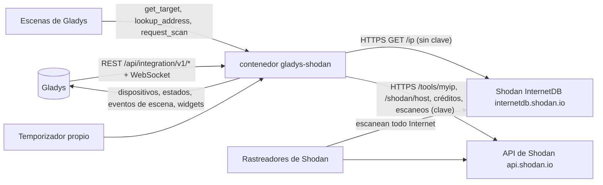
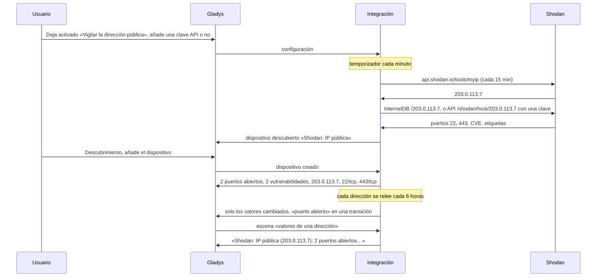
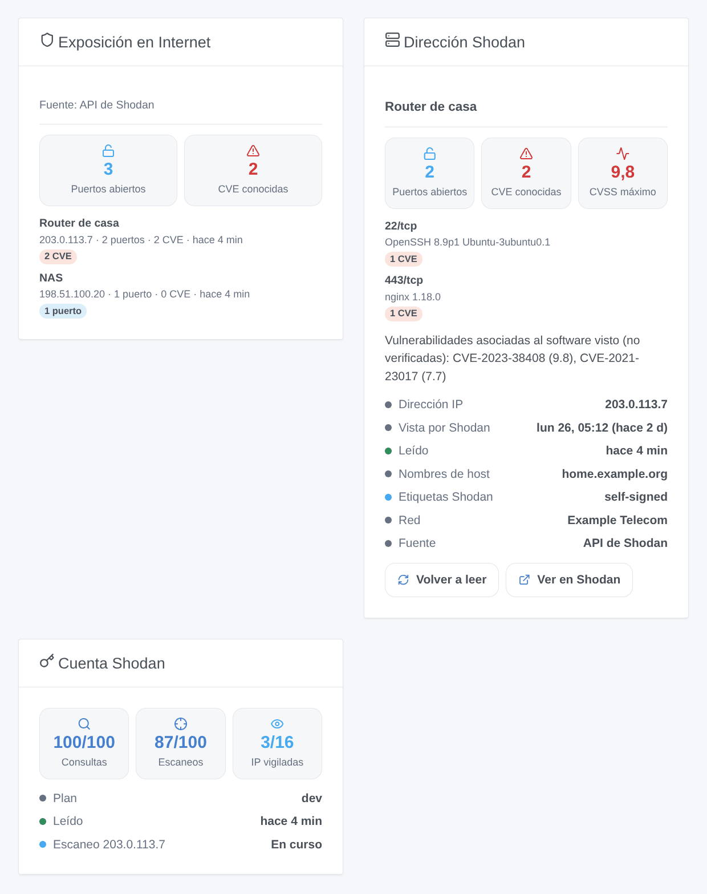

# Gladys Shodan

[English](README.md) · [Français](README.fr.md) · [Deutsch](README.de.md) · **Español**

[](LICENSE)
[](https://github.com/William-De71/gladys-shodan/releases)
[](https://github.com/William-De71/gladys-shodan/actions/workflows/release.yml)
[](https://gladysassistant.com)


Integración externa de [Gladys Assistant](https://gladysassistant.com) para **Shodan**: muestra en Gladys lo que Internet ve de su casa, tal como Shodan lo conoce — los puertos abiertos, las vulnerabilidades (CVE) asociadas al software que Shodan vio, sus etiquetas — y lanza escenas cuando se abre un puerto, aparece una vulnerabilidad o cambia la dirección pública. Shodan escanea todo Internet; la integración solo **pregunta** a Shodan lo que sabe de las direcciones vigiladas, nunca escanea nada desde Gladys. Sin clave usa [Shodan InternetDB](https://internetdb.shodan.io), gratuita; con la clave API opcional de una cuenta Shodan, la [API de Shodan](https://developer.shodan.io/api) añade las versiones del software, las puntuaciones CVSS y la fecha del último escaneo — solo lectura.

Documentación de usuario: [English](docs/en.md) · [Français](docs/fr.md) · [Deutsch](docs/de.md) · [Español](docs/es.md).

No afiliada a Shodan. Solo las direcciones vigiladas se envían a Shodan. Vigile solo sus propias direcciones.

## Funciones

- La **dirección pública de la casa** (la que usa el router), preguntada a Shodan cada 15 minutos y seguida cuando cambia, más hasta **10 direcciones más** (direcciones IP públicas o nombres de host: un nombre DNS dinámico, un servidor).
- **Un dispositivo por dirección vigilada**: número de puertos abiertos, número de vulnerabilidades, la dirección leída y la lista de puertos.
- **7 disparadores de escena** (puerto abierto, puerto cerrado, vulnerabilidad encontrada, vulnerabilidad desaparecida, nueva etiqueta, IP pública cambiada, clave API rechazada), **3 acciones de escena** (valores de una dirección, consultar una dirección, escanear una dirección) y **3 widgets del panel** (Exposición en Internet, Dirección Shodan, Cuenta Shodan).
- **Dos fuentes**: Shodan InternetDB sin clave (gratuita para uso no comercial, sin cuenta); la API de Shodan con una clave (software y versión por servicio, puntuación CVSS y descripción de cada CVE, fecha en que Shodan vio la dirección por última vez, organización, créditos, escaneo a petición con un plan de pago).
- **Solo lectura**: la integración hace preguntas, no cambia nada en la cuenta Shodan y no escanea nada por sí misma. La clave API nunca se escribe en `/data`.
- Cuatro idiomas en todas partes: inglés, francés, alemán, español.

## Cómo funciona




De la configuración a una escena:



### Transporte

`transports: ["cloud"]`: los datos vienen de `internetdb.shodan.io` y `api.shodan.io`. **Solo las direcciones vigiladas salen de su red** (y la clave API, solo hacia `api.shodan.io`, si da una); lo que Shodan sabe de ellas viene de sus propios escaneos de Internet. Los nombres de host los resuelve el DNS del contenedor. `/data/shodan.json` (modo 0600) guarda las últimas lecturas, lo que saben los disparadores, los créditos y los escaneos pedidos — nunca la clave API.

## Dispositivos y funciones

| Dispositivo                                                                                           | Funciones (categoría / tipo)                                                                                                                                          |
| ----------------------------------------------------------------------------------------------------- | --------------------------------------------------------------------------------------------------------------------------------------------------------------------- |
| «Shodan: IP pública» para la dirección pública, «Shodan &lt;dirección&gt;» para cada una de las demás | Puertos abiertos (`counter-sensor` / `integer`), vulnerabilidades (`counter-sensor` / `integer`), dirección IP (`text` / `text`), puertos expuestos (`text` / `text`) |

- Los dispositivos se ofrecen en la pantalla de Descubrimiento: usted añade los que quiera.
- «Shodan: IP pública» sigue siendo el mismo dispositivo cuando cambia la dirección pública; la función Dirección IP muestra la dirección leída.
- Las vulnerabilidades son las CVE que Shodan asoció al software visto, según sus versiones: **no están verificadas** en la máquina.
- Los puertos expuestos se escriben «22/tcp, 443/tcp» con una clave, «22, 443» sin ella (InternetDB no da el transporte).
- Todas las funciones son de solo lectura y guardan su historial: «vulnerabilidades > 0» es una condición de dispositivo de Gladys.
- External ids: `ext:…:target:public` para la dirección pública, `ext:…:target:<dirección>` para las demás.

## Disparadores, acciones de escena y widgets



**Widgets**:

- **Exposición en Internet**: mosaicos con el total de puertos abiertos y vulnerabilidades, luego una tarjeta por dirección, la más preocupante primero (etiquetas de alarma compromised / malware / doublepulsar, luego CVE, luego errores, luego puertos abiertos), cada una con sus puertos, CVE, etiquetas y un enlace a su página en shodan.io; una leyenda indica la fuente.
- **Dirección Shodan**: una dirección (ajuste: un dispositivo; vacío = la dirección pública): mosaicos puertos, vulnerabilidades y CVSS más alto (con una clave), una tarjeta por puerto / servicio con su producto, versión y CVE (puntuaciones y descripciones), un texto que lista las CVE, líneas de estado (IP, vista por Shodan, leída, nombres de host, etiquetas, red, fuente), un botón **Volver a leer** (una vez por minuto como máximo) y un botón **Ver en Shodan**.
- **Cuenta Shodan**: créditos de consulta, créditos de escaneo e IP vigiladas frente a sus límites, el plan, los últimos escaneos; sin clave indica que hace falta una clave.

**Disparadores** (un evento por transición, nunca en la primera lectura, nunca como resultado de una acción de escena; como máximo 10 eventos de un mismo tipo por dirección y por lectura):

- **puerto abierto** / **puerto cerrado** (filtros: dirección, número de puerto; variables: objetivo, nombre del objetivo, IP, puertos, puerto, y transporte y producto con una clave);
- **vulnerabilidad encontrada** (filtro: dirección; variables: CVE, puntuación CVSS y resumen con una clave, `url` = su página NVD) / **vulnerabilidad desaparecida** (CVE, `url`);
- **nueva etiqueta** (filtros: dirección, etiquetas: compromised, malware, honeypot, doublepulsar, eol-product, eol-os, self-signed, starttls, database, devops, iot, ics, medical, videogame, vpn, proxy, tor, cdn, cloud, scanner; variable: etiqueta);
- **IP pública cambiada** (variables: IP anterior, IP; comprobada cada 15 minutos);
- **clave API rechazada** (motivo `refused` y un mensaje), una vez por rechazo; un plan que rechaza las consultas de host (HTTP 403) no lo lanza.

Una dirección nueva o un cambio de fuente (clave añadida o quitada) parte de una nueva base sin eventos: lo que Shodan sabe de una dirección recién asignada puede describir a su titular anterior.

**Acciones**:

- **valores de una dirección**: desde la última lectura, sin petición (campo: un dispositivo dirección, vacío = la dirección pública o la primera); salidas: nombre del objetivo, IP, número de puertos, puertos, número de vulnerabilidades, vulnerabilidades, CVSS más alto, etiquetas, nombres de host, fuente (`internetdb` o `api`), último escaneo (ISO 8601, con una clave), hora de lectura, y una frase (`summary`), por ejemplo «Shodan: IP pública (203.0.113.7): 2 puertos abiertos (22/tcp, 443/tcp), 2 vulnerabilidades (CVSS 9.8). Etiquetas de Shodan: self-signed.»;
- **consultar una dirección**: cualquier IP pública o nombre de host, una petición en el momento; salidas: IP, encontrada, número de puertos, puertos, número de vulnerabilidades, vulnerabilidades, CVSS más alto, etiquetas, nombres de host, fuente, `summary`;
- **escanear una dirección**: pide a Shodan escanear ahora un dispositivo dirección (clave API y créditos de escaneo de un plan de pago, 1 crédito por dirección); salidas: identificador del escaneo, IP, créditos restantes. La dirección se vuelve a leer cuando termina el escaneo.

Ejemplos:

- Cuando **Shodan: puerto abierto** en la IP pública → enviar «El puerto {{triggerEvent.data.port}} está abierto en {{triggerEvent.data.ip}}».
- Cuando **Shodan: vulnerabilidad encontrada** → enviar «{{triggerEvent.data.cve}}: {{triggerEvent.data.url}}».
- Cada lunes a las 8:00 → **Shodan: valores de una dirección** → enviar su `summary`.
- Cuando **Shodan: IP pública cambiada** → enviar «Nueva dirección pública: {{triggerEvent.data.ip}}».

## Requisitos

- Gladys Assistant **5.3.0** o posterior (widgets y escenas de las integraciones): las instancias más antiguas no pueden instalar la integración.
- Internet: la integración solo habla con `internetdb.shodan.io` y `api.shodan.io`.
- Opcional: una [cuenta Shodan](https://account.shodan.io) y su clave API. Shodan InternetDB solo es gratuita para uso no comercial.

### El ritmo de la API

Shodan pide una petición por segundo como máximo: las peticiones salen con 1,1 s de separación. Un temporizador comprueba cada minuto lo que toca: la dirección pública cada 15 minutos; cada dirección cada 6 horas, o en el momento si su IP cambió; un nuevo intento 30 minutos después de un fallo; los créditos cada 6 horas; un escaneo pedido se sigue cada 2 minutos hasta que termina y luego se vuelve a leer la dirección. Un 429 o un error del servidor solo pausa ese servicio (InternetDB o la API). Una clave rechazada (HTTP 401): InternetDB responde mientras tanto, el disparador salta una vez y la clave se vuelve a probar cada 6 horas. Un plan que rechaza las consultas de host (HTTP 403): se usa InternetDB durante 24 horas. Shodan actualiza InternetDB más o menos una vez por semana: la mayoría de las lecturas no traen nada nuevo.

## Instalación

- **Desde la tienda**: Integraciones → Shodan → Instalar.
- **Desde la URL del repositorio**: Integraciones → integración externa → `https://github.com/William-De71/gladys-shodan`.
- **Modo desarrollador**: ejecute `npm start` con las variables que da Gladys (vea Desarrollo).

## Configuración

| Campo o botón                           | Por defecto | Significado                                                                                                                                                     |
| --------------------------------------- | ----------- | --------------------------------------------------------------------------------------------------------------------------------------------------------------- |
| Vigilar la dirección pública de la casa | activado    | La dirección que usa el router, preguntada a Shodan cada 15 minutos; se sigue un cambio de dirección                                                            |
| Otras direcciones                       | —           | Direcciones IP públicas o nombres de host, separados por comas, 10 como máximo; las entradas privadas, locales o no válidas se ignoran y se listan en el estado |
| Clave API                               | —           | Opcional, un secreto: nunca se vuelve a mostrar, nunca se registra, nunca se escribe en `/data`                                                                 |
| Idioma de los textos                    | automático  | Nombres de las funciones, textos de las escenas y errores (automático: idioma del último widget)                                                                |
| Probar la conexión / Diagnóstico        | —           | La dirección pública, cada dirección y la clave leídas en el momento; el estado en los registros, nunca la clave                                                |

## Uso

1. Opcional: cree una cuenta Shodan y copie su clave API desde [account.shodan.io](https://account.shodan.io).
2. En Gladys (Integraciones → Shodan → Configuración): mantenga vigilada la dirección pública, añada sus otras direcciones, pegue la clave; pulse **Probar la conexión**.
3. **Descubrimiento**, luego añada las direcciones que quiera como dispositivos.
4. Añada los widgets a un panel, cree escenas con las funciones, los disparadores y las acciones.

## Desarrollo

```bash
npm install
npm test                       # node --test, un Shodan falso (test/helpers/fake-shodan.js), nunca la red
UPDATE_BASELINE=1 npm test     # reescribe test/fixtures/discovery.baseline.json (solo a propósito)
npm run lint                   # ESLint
npm run format:check           # Prettier
npx github:GladysAssistant/integration-store . --skip-image-check
scripts/build-cover.sh         # cover.jpg desde docs/assets/cover.svg
docs/illustrations/render.sh   # docs/assets/widgets.<idioma>.png
node .github/scripts/release.mjs next   # la versión que recibiría la próxima publicación
```

En local, el SDK lee `GLADYS_HOST_API_URL`, `GLADYS_INTEGRATION_TOKEN` y `GLADYS_INTEGRATION_SELECTOR` (dados por Gladys en modo desarrollador), y la integración lee `TZ`. `DEBUG=gladys-integration-sdk` muestra los registros del SDK.

Las pruebas cubren el cliente HTTP (InternetDB y la API, la clave y el plan rechazados, las pausas, la separación de las peticiones), los analizadores, los disparadores, los dispositivos (los campos que exige la pantalla de descubrimiento, los pares categoría / tipo del núcleo), los widgets (`validateWidgetContent`), el manifiesto, los cuatro idiomas, el script de publicación, y toda la integración frente al Gladys falso del SDK y un Shodan falso. `test/structure.test.js` congela cada clave que guardan los usuarios.

## Proceso de publicación


Cada fusión en `main` lanza la CI y luego calcula la versión a partir de los [Conventional Commits](https://www.conventionalcommits.org/) desde la última etiqueta: `feat` → menor, `fix` / `perf` → parche, `!` o `BREAKING CHANGE` → mayor (una menor por debajo de 1.0.0); `docs`, `chore`, `ci`, `test`, `style`, `refactor`, `build` solos no publican nada. Se genera la sección del changelog, se sube la etiqueta, se construye la imagen multiarquitectura, luego `main` recibe el commit de publicación, se crea la GitHub Release y un último job comprueba la imagen pública, el validador de la tienda y el topic.

- El título de la pull request se convierte en el commit squash y luego en la línea del changelog: escríbalo en inglés, para el usuario (`pr-title.yml` lo comprueba). Nunca edite `CHANGELOG.md` a mano.
- La 1.0.0 es una decisión: Actions → Release → Run workflow con `release-as: 1.0.0`. `dry-run` muestra la versión y las notas sin publicar.
- **Rama protegida**: la publicación sube su commit a `main` con `GITHUB_TOKEN`. El ruleset `protect-main` (sin borrado, sin force-push) lo deja pasar; una regla más estricta (pull request obligatoria, status checks) necesitaría GitHub Actions en la lista de excepciones, o una GitHub App.
- Tras la primera publicación, haga público el paquete `ghcr.io` (Package settings → Change visibility), o Gladys no podrá descargarlo.

## Solución de problemas

Vea [docs/es.md](docs/es.md#solución-de-problemas). Informe de los problemas con las versiones de Gladys y de la integración, el mensaje de **Probar la conexión** y el resultado de **Diagnóstico** (en los registros de la integración). Nunca pegue su clave API.

## Contribuir

Las incidencias y pull requests son bienvenidas. Ejecute `npm run format:check && npm run lint && npm test` antes de abrir una pull request, y mantenga sin cambios cada external id y cada clave guardada (vea [CLAUDE.md](CLAUDE.md)).

## Seguridad

Vea [SECURITY.md](SECURITY.md): informe de las vulnerabilidades en privado. La clave API es un campo `secret`: nunca se registra, nunca se escribe en `/data`, solo se envía a `api.shodan.io`. **Diagnóstico** nunca la escribe. `/data/shodan.json` se escribe con modo 0600.

## Capturas pendientes

Las imágenes de arriba son ilustraciones, no capturas de pantalla. Las capturas reales irán en `docs/assets/screenshots/` (PNG, 1280 × 800): `configuration.png` (la pantalla de configuración con la dirección pública, las otras direcciones y la clave), `discovery.png` (los dispositivos Shodan ofrecidos), `device.png` (una dirección con sus funciones), `scene-port-opened.png` (una escena con el disparador «puerto abierto»), `dashboard.png` (los tres widgets con direcciones reales).

## Licencia

[Licencia Apache 2.0](LICENSE) — vea también [NOTICE](NOTICE). Shodan es una marca de su propietario. Gracias a la documentación y al SDK de Gladys, y a Shodan por InternetDB y la documentación de su API.
