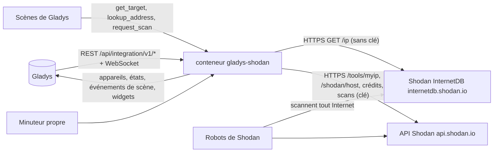
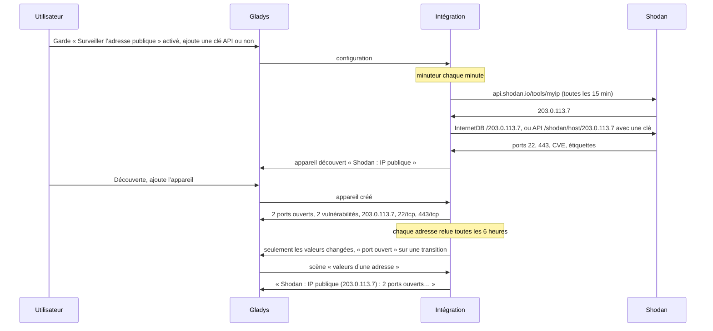
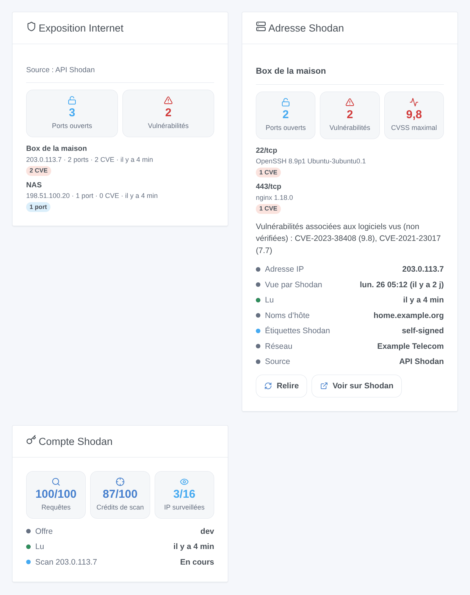

# Gladys Shodan

[English](README.md) · **Français** · [Deutsch](README.de.md) · [Español](README.es.md)

[](LICENSE)
[](https://github.com/William-De71/gladys-shodan/releases)
[](https://github.com/William-De71/gladys-shodan/actions/workflows/release.yml)
[](https://gladysassistant.com)


Intégration externe de [Gladys Assistant](https://gladysassistant.com) pour **Shodan** : elle affiche dans Gladys ce qu’Internet voit de votre maison, tel que Shodan le connaît — les ports ouverts, les vulnérabilités (CVE) associées aux logiciels vus par Shodan, ses étiquettes — et déclenche des scènes quand un port s’ouvre, qu’une vulnérabilité apparaît ou que l’adresse publique change. Shodan scanne tout Internet ; l’intégration se contente de **demander** à Shodan ce qu’il sait des adresses surveillées, elle ne scanne jamais rien depuis Gladys. Sans clé, elle utilise [Shodan InternetDB](https://internetdb.shodan.io), gratuit ; avec la clé API facultative d’un compte Shodan, l’[API Shodan](https://developer.shodan.io/api) ajoute les versions des logiciels, les scores CVSS et la date du dernier scan — en lecture seule.

Documentation utilisateur : [English](docs/en.md) · [Français](docs/fr.md) · [Deutsch](docs/de.md) · [Español](docs/es.md).

Non affiliée à Shodan. Seules les adresses surveillées sont envoyées à Shodan. Ne surveillez que vos propres adresses.

## Fonctionnalités

- L’**adresse publique de la maison** (celle qu’utilise la box), demandée à Shodan toutes les 15 minutes et suivie quand elle change, plus jusqu’à **10 autres adresses** (adresses IP publiques ou noms d’hôte : un nom DNS dynamique, un serveur).
- **Un appareil par adresse surveillée** : nombre de ports ouverts, nombre de vulnérabilités, l’adresse lue et la liste des ports.
- **7 déclencheurs de scène** (port ouvert, port fermé, vulnérabilité trouvée, vulnérabilité disparue, nouvelle étiquette, IP publique changée, clé API refusée), **3 actions de scène** (valeurs d’une adresse, consulter une adresse, scanner une adresse) et **3 widgets** (Exposition Internet, Adresse Shodan, Compte Shodan).
- **Deux sources** : Shodan InternetDB sans clé (gratuit pour un usage non commercial, sans compte) ; l’API Shodan avec une clé (logiciel et version par service, score CVSS et description de chaque CVE, date à laquelle Shodan a vu l’adresse pour la dernière fois, organisation, crédits, scan à la demande avec une offre payante).
- **Lecture seule** : l’intégration pose des questions, elle ne modifie rien dans le compte Shodan et ne scanne rien elle-même. La clé API n’est jamais écrite dans `/data`.
- Quatre langues partout : anglais, français, allemand, espagnol.

## Fonctionnement




De la configuration à une scène :



### Transport

`transports: ["cloud"]` : les données viennent de `internetdb.shodan.io` et `api.shodan.io`. **Seules les adresses surveillées quittent votre réseau** (et la clé API, vers `api.shodan.io` seulement, si vous en donnez une) ; ce que Shodan sait d’elles vient de ses propres scans d’Internet. Les noms d’hôte sont résolus par le DNS du conteneur. `/data/shodan.json` (mode 0600) garde les dernières lectures, ce que savent les déclencheurs, les crédits et les scans demandés — jamais la clé API.

## Appareils et fonctionnalités

| Appareil                                                                                       | Fonctionnalités (catégorie / type)                                                                                                                         |
| ---------------------------------------------------------------------------------------------- | ---------------------------------------------------------------------------------------------------------------------------------------------------------- |
| « Shodan : IP publique » pour l’adresse publique, « Shodan &lt;adresse&gt; » pour chaque autre | Ports ouverts (`counter-sensor` / `integer`), vulnérabilités (`counter-sensor` / `integer`), adresse IP (`text` / `text`), ports exposés (`text` / `text`) |

- Les appareils sont proposés sur l’écran Découverte : vous ajoutez ceux que vous voulez.
- « Shodan : IP publique » reste le même appareil quand l’adresse publique change ; la fonctionnalité Adresse IP montre l’adresse lue.
- Les vulnérabilités sont les CVE que Shodan a associées aux logiciels vus, d’après leurs versions : elles ne sont **pas vérifiées** sur la machine.
- Les ports exposés s’écrivent « 22/tcp, 443/tcp » avec une clé, « 22, 443 » sans (InternetDB ne donne pas le transport).
- Toutes les fonctionnalités sont en lecture seule et gardent leur historique : « vulnérabilités > 0 » est une condition d’appareil de Gladys.
- Les external ids : `ext:…:target:public` pour l’adresse publique, `ext:…:target:<adresse>` pour les autres.

## Déclencheurs, actions de scène et widgets



**Widgets** :

- **Exposition Internet** : des tuiles avec le total des ports ouverts et des vulnérabilités, puis une carte par adresse, la plus préoccupante d’abord (étiquettes d’alarme compromised / malware / doublepulsar, puis CVE, puis erreurs, puis ports ouverts), chacune avec ses ports, ses CVE, ses étiquettes et un lien vers sa page sur shodan.io ; une légende indique la source.
- **Adresse Shodan** : une adresse (réglage : un appareil ; vide = l’adresse publique) : tuiles ports, vulnérabilités et CVSS le plus élevé (avec une clé), une carte par port / service avec son produit, sa version et ses CVE (scores et descriptions), un texte qui liste les CVE, des lignes d’état (IP, vue par Shodan, lue, noms d’hôte, étiquettes, réseau, source), un bouton **Relire** (une fois par minute au plus) et un bouton **Voir sur Shodan**.
- **Compte Shodan** : crédits de requête, crédits de scan et IP surveillées face à leurs limites, l’offre, les derniers scans ; sans clé, il indique qu’une clé est nécessaire.

**Déclencheurs** (un événement par transition, jamais à la première lecture, jamais à la suite d’une action de scène ; 10 événements d’un même type au plus par adresse et par lecture) :

- **port ouvert** / **port fermé** (filtres : adresse, numéro de port ; variables : cible, nom de la cible, IP, ports, port, et transport et produit avec une clé) ;
- **vulnérabilité trouvée** (filtre : adresse ; variables : CVE, score CVSS et résumé avec une clé, `url` = sa page NVD) / **vulnérabilité disparue** (CVE, `url`) ;
- **nouvelle étiquette** (filtres : adresse, étiquettes : compromised, malware, honeypot, doublepulsar, eol-product, eol-os, self-signed, starttls, database, devops, iot, ics, medical, videogame, vpn, proxy, tor, cdn, cloud, scanner ; variable : étiquette) ;
- **IP publique changée** (variables : IP précédente, IP ; vérifiée toutes les 15 minutes) ;
- **clé API refusée** (raison `refused` et un message), une fois par refus ; une offre qui refuse les consultations d’hôte (HTTP 403) ne le déclenche pas.

Une nouvelle adresse ou un changement de source (clé ajoutée ou retirée) repart d’une nouvelle base sans événement : ce que Shodan sait d’une adresse tout juste attribuée peut décrire son précédent titulaire.

**Actions** :

- **valeurs d’une adresse** : depuis la dernière lecture, sans requête (champ : un appareil adresse, vide = l’adresse publique ou la première) ; sorties : nom de la cible, IP, nombre de ports, ports, nombre de vulnérabilités, vulnérabilités, CVSS le plus élevé, étiquettes, noms d’hôte, source (`internetdb` ou `api`), dernier scan (ISO 8601, avec une clé), heure de lecture, et une phrase (`summary`), par exemple « Shodan : IP publique (203.0.113.7) : 2 ports ouverts (22/tcp, 443/tcp), 2 vulnérabilités (CVSS 9.8). Étiquettes Shodan : self-signed. » ;
- **consulter une adresse** : n’importe quelle IP publique ou nom d’hôte, une requête tout de suite ; sorties : IP, trouvée, nombre de ports, ports, nombre de vulnérabilités, vulnérabilités, CVSS le plus élevé, étiquettes, noms d’hôte, source, `summary` ;
- **scanner une adresse** : demande à Shodan de scanner tout de suite un appareil adresse (clé API et crédits de scan d’une offre payante, 1 crédit par adresse) ; sorties : identifiant du scan, IP, crédits restants. L’adresse est relue quand le scan est terminé.

Exemples :

- Quand **Shodan : port ouvert** sur l’IP publique → envoyer « Le port {{triggerEvent.data.port}} est ouvert sur {{triggerEvent.data.ip}} ».
- Quand **Shodan : vulnérabilité trouvée** → envoyer « {{triggerEvent.data.cve}} : {{triggerEvent.data.url}} ».
- Chaque lundi à 8 h → **Shodan : valeurs d’une adresse** → envoyer son `summary`.
- Quand **Shodan : IP publique changée** → envoyer « Nouvelle adresse publique : {{triggerEvent.data.ip}} ».

## Prérequis

- Gladys Assistant **5.3.0** ou plus récent (widgets et scènes des intégrations) : les instances plus anciennes ne peuvent pas installer l’intégration.
- Internet : l’intégration ne parle qu’à `internetdb.shodan.io` et `api.shodan.io`.
- Facultatif : un [compte Shodan](https://account.shodan.io) et sa clé API. Shodan InternetDB n’est gratuit que pour un usage non commercial.

### Le rythme de l’API

Shodan demande une requête par seconde au plus : les requêtes partent à 1,1 s d’intervalle. Un minuteur vérifie chaque minute ce qui est dû : l’adresse publique toutes les 15 minutes ; chaque adresse toutes les 6 heures, ou tout de suite quand son IP a changé ; un nouvel essai 30 minutes après un échec ; les crédits toutes les 6 heures ; un scan demandé est suivi toutes les 2 minutes jusqu’à sa fin, puis l’adresse est relue. Un 429 ou une erreur serveur ne met en pause que ce service (InternetDB ou l’API). Une clé refusée (HTTP 401) : InternetDB répond en attendant, le déclencheur part une fois et la clé est réessayée toutes les 6 heures. Une offre qui refuse les consultations d’hôte (HTTP 403) : InternetDB est utilisé pendant 24 heures. Shodan rafraîchit InternetDB environ une fois par semaine : la plupart des lectures n’apportent rien de nouveau.

## Installation

- **Depuis le store** : Intégrations → Shodan → Installer.
- **Depuis l’URL du dépôt** : Intégrations → intégration externe → `https://github.com/William-De71/gladys-shodan`.
- **Mode développeur** : lancez `npm start` avec les variables données par Gladys (voir Développement).

## Configuration

| Champ ou bouton                            | Par défaut  | Signification                                                                                                                                                  |
| ------------------------------------------ | ----------- | -------------------------------------------------------------------------------------------------------------------------------------------------------------- |
| Surveiller l’adresse publique de la maison | activé      | L’adresse qu’utilise la box, demandée à Shodan toutes les 15 minutes ; un changement d’adresse est suivi                                                       |
| Autres adresses                            | —           | Adresses IP publiques ou noms d’hôte, séparés par des virgules, 10 au maximum ; les entrées privées, locales ou invalides sont ignorées et listées dans l’état |
| Clé API                                    | —           | Facultative, un secret : jamais réaffichée, jamais journalisée, jamais écrite dans `/data`                                                                     |
| Langue des textes                          | automatique | Noms des fonctionnalités, textes des scènes et erreurs (automatique : langue du dernier widget)                                                                |
| Tester la connexion / Diagnostic           | —           | L’adresse publique, chaque adresse et la clé lues tout de suite ; l’état dans les journaux, jamais la clé                                                      |

## Utilisation

1. Facultatif : créez un compte Shodan et copiez sa clé API depuis [account.shodan.io](https://account.shodan.io).
2. Dans Gladys (Intégrations → Shodan → Configuration) : gardez l’adresse publique surveillée, ajoutez vos autres adresses, collez la clé ; cliquez sur **Tester la connexion**.
3. **Découverte**, puis ajoutez les adresses voulues comme appareils.
4. Ajoutez les widgets à un tableau de bord, construisez des scènes avec les fonctionnalités, les déclencheurs et les actions.

## Développement

```bash
npm install
npm test                       # node --test, un faux Shodan (test/helpers/fake-shodan.js), jamais le réseau
UPDATE_BASELINE=1 npm test     # réécrit test/fixtures/discovery.baseline.json (volontairement seulement)
npm run lint                   # ESLint
npm run format:check           # Prettier
npx github:GladysAssistant/integration-store . --skip-image-check
scripts/build-cover.sh         # cover.jpg depuis docs/assets/cover.svg
docs/illustrations/render.sh   # docs/assets/widgets.<langue>.png
node .github/scripts/release.mjs next   # la version que recevrait la prochaine release
```

En local, le SDK lit `GLADYS_HOST_API_URL`, `GLADYS_INTEGRATION_TOKEN` et `GLADYS_INTEGRATION_SELECTOR` (donnés par Gladys en mode développeur), et l’intégration lit `TZ`. `DEBUG=gladys-integration-sdk` affiche les journaux du SDK.

Les tests couvrent le client HTTP (InternetDB et l’API, la clé et l’offre refusées, les pauses, l’espacement des requêtes), les lecteurs de réponses, les déclencheurs, les appareils (les champs qu’exige l’écran de découverte, les couples catégorie / type du cœur), les widgets (`validateWidgetContent`), le manifeste, les quatre langues, le script de release, et toute l’intégration face au faux Gladys du SDK et à un faux Shodan. `test/structure.test.js` fige chaque clé que les utilisateurs enregistrent.

## Processus de release


Chaque fusion sur `main` lance la CI, puis calcule la version depuis les [Conventional Commits](https://www.conventionalcommits.org/) depuis le dernier tag : `feat` → mineure, `fix` / `perf` → correctif, `!` ou `BREAKING CHANGE` → majeure (une mineure sous 1.0.0) ; `docs`, `chore`, `ci`, `test`, `style`, `refactor`, `build` seuls ne publient rien. La section du changelog est générée, le tag poussé, l’image multi-architecture construite, puis `main` reçoit le commit de release, la GitHub Release est créée et un dernier job vérifie l’image publique, le validateur du store et le topic.

- Le titre de la pull request devient le commit squash, puis la ligne du changelog : écrivez-le en anglais, pour l’utilisateur (`pr-title.yml` le vérifie). Ne modifiez jamais `CHANGELOG.md` à la main.
- La 1.0.0 est une décision : Actions → Release → Run workflow avec `release-as: 1.0.0`. `dry-run` montre la version et les notes sans rien publier.
- **Branche protégée** : la release pousse son commit sur `main` avec `GITHUB_TOKEN`. Le ruleset `protect-main` (ni suppression, ni force-push) le laisse passer ; une règle plus stricte (pull request obligatoire, status checks) demanderait d’ajouter GitHub Actions aux contournements, ou une GitHub App.
- Après la première release, rendez public le paquet `ghcr.io` (Package settings → Change visibility), sinon Gladys ne peut pas le télécharger.

## Dépannage

Voir [docs/fr.md](docs/fr.md#dépannage). Signalez les problèmes avec les versions de Gladys et de l’intégration, le message de **Tester la connexion** et le résultat de **Diagnostic** (dans les journaux de l’intégration). Ne collez jamais votre clé API.

## Contribuer

Les tickets et pull requests sont les bienvenus. Lancez `npm run format:check && npm run lint && npm test` avant d’ouvrir une pull request, et gardez inchangés chaque external id et chaque clé enregistrée (voir [CLAUDE.md](CLAUDE.md)).

## Sécurité

Voir [SECURITY.md](SECURITY.md) : signalez les vulnérabilités en privé. La clé API est un champ `secret` : jamais journalisée, jamais écrite dans `/data`, envoyée uniquement à `api.shodan.io`. **Diagnostic** ne l’écrit jamais. `/data/shodan.json` est écrit en mode 0600.

## Captures à venir

Les images ci-dessus sont des illustrations, pas des captures d’écran. Les vraies captures iront dans `docs/assets/screenshots/` (PNG, 1280 × 800) : `configuration.png` (l’écran de configuration avec l’adresse publique, les autres adresses et la clé), `discovery.png` (les appareils Shodan proposés), `device.png` (une adresse avec ses fonctionnalités), `scene-port-opened.png` (une scène sur le déclencheur « port ouvert »), `dashboard.png` (les trois widgets avec de vraies adresses).

## Licence

[Licence Apache 2.0](LICENSE) — voir aussi [NOTICE](NOTICE). Shodan est une marque de son propriétaire. Merci à la documentation et au SDK de Gladys, et à Shodan pour InternetDB et la documentation de son API.
