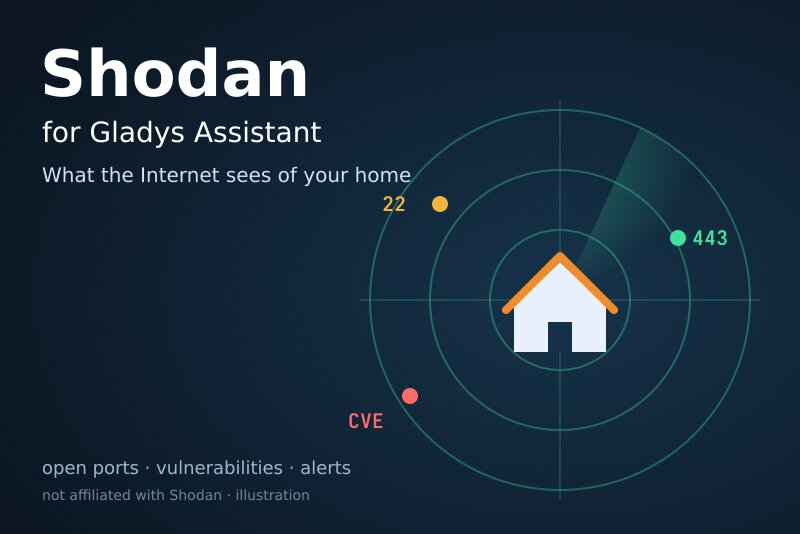
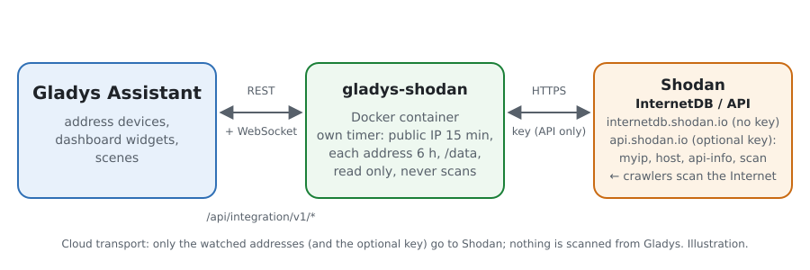
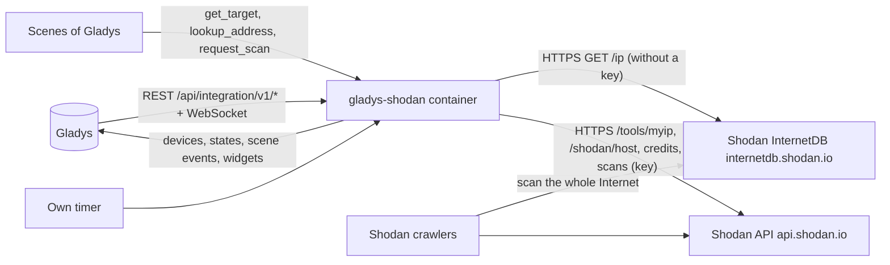
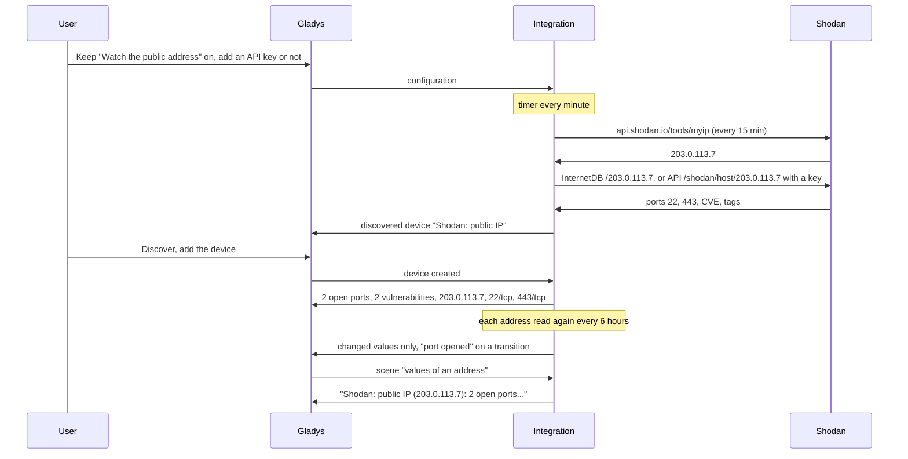
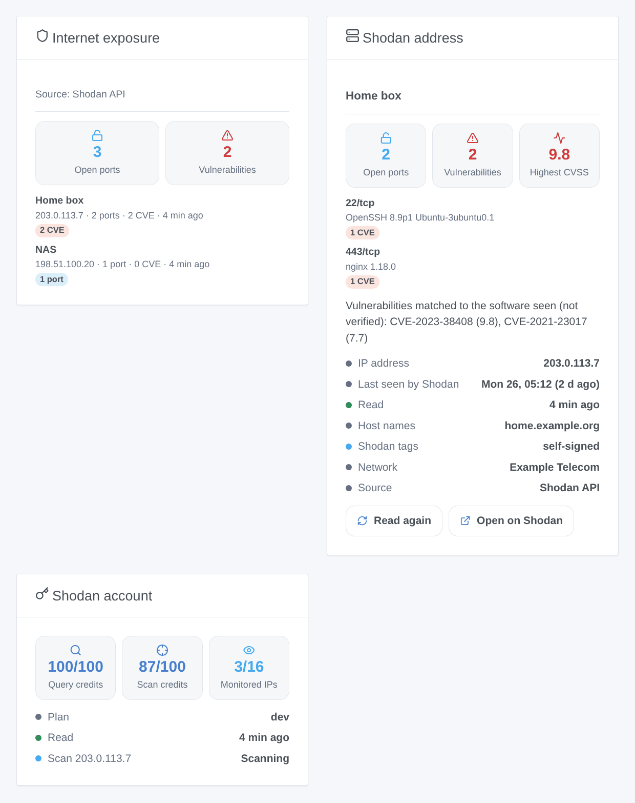

# Gladys Shodan

**English** · [Français](README.fr.md) · [Deutsch](README.de.md) · [Español](README.es.md)

[](LICENSE)
[](https://github.com/William-De71/gladys-shodan/releases)
[](https://github.com/William-De71/gladys-shodan/actions/workflows/release.yml)
[](https://gladysassistant.com)



[Gladys Assistant](https://gladysassistant.com) external integration for **Shodan**: it shows in Gladys what the Internet sees of your home, as Shodan knows it — the open ports, the vulnerabilities (CVE) matched to the software Shodan saw, its tags — and fires scenes when a port opens, a vulnerability appears or the public address changes. Shodan scans the whole Internet; the integration only **asks** Shodan what it knows about the watched addresses, it never scans anything from Gladys. Without a key it uses the free [Shodan InternetDB](https://internetdb.shodan.io); with the optional API key of a Shodan account, the [Shodan API](https://developer.shodan.io/api) adds the software versions, the CVSS scores and the date of the last scan — read only.

User documentation: [English](docs/en.md) · [Français](docs/fr.md) · [Deutsch](docs/de.md) · [Español](docs/es.md).

Not affiliated with Shodan. Only the watched addresses are sent to Shodan. Watch only addresses you own.

## Features

- The **public address of the home** (the address the box uses), asked to Shodan every 15 minutes and followed when it changes, plus up to **10 other addresses** (public IP addresses or host names: a dynamic DNS name, a server).
- **One device per watched address**: number of open ports, number of vulnerabilities, the address read and the list of ports.
- **7 scene triggers** (port opened, port closed, vulnerability found, vulnerability gone, tag added, public IP changed, API key refused), **3 scene actions** (values of an address, look up an address, scan an address) and **3 dashboard widgets** (Internet exposure, Shodan address, Shodan account).
- **Two sources**: Shodan InternetDB without a key (free for non-commercial use, no account); the Shodan API with a key (software and version per service, CVSS score and description of each CVE, date Shodan last saw the address, organisation, credits, on-demand scan with a paid plan).
- **Read only**: the integration asks questions, it changes nothing in the Shodan account and scans nothing itself. The API key is never written to `/data`.
- Four languages everywhere: English, French, German, Spanish.

## How it works





From the configuration to a scene:



### Transport

`transports: ["cloud"]`: the data come from `internetdb.shodan.io` and `api.shodan.io`. **Only the watched addresses leave your network** (and the API key, to `api.shodan.io` only, when you give one); what Shodan knows about them comes from its own scans of the Internet. Host names are resolved by the DNS of the container. `/data/shodan.json` (mode 0600) keeps the last readings, what the triggers know, the credits and the scans asked — never the API key.

## Devices and features

| Device                                                                              | Features (category / type)                                                                                                                               |
| ----------------------------------------------------------------------------------- | -------------------------------------------------------------------------------------------------------------------------------------------------------- |
| "Shodan: public IP" for the public address, "Shodan &lt;address&gt;" for each other | Open ports (`counter-sensor` / `integer`), vulnerabilities (`counter-sensor` / `integer`), IP address (`text` / `text`), exposed ports (`text` / `text`) |

- The devices are offered on the Discovery screen: you add the ones you want.
- "Shodan: public IP" stays the same device when the public address changes; the IP address feature shows the address read.
- Vulnerabilities are the CVE Shodan matched to the software it saw, from their versions: they are **not verified** on the machine.
- Exposed ports read "22/tcp, 443/tcp" with a key, "22, 443" without (InternetDB gives no transport).
- Every feature is read only and keeps its history: "vulnerabilities > 0" is a device condition of Gladys.
- External ids: `ext:…:target:public` for the public address, `ext:…:target:<address>` for the others.

## Scene triggers, actions and widgets



**Widgets**:

- **Internet exposure**: tiles with the total open ports and vulnerabilities, then one card per address, the worst first (alarm tags compromised / malware / doublepulsar, then CVE, then errors, then open ports), each with its ports, CVE, tags and a link to its page on shodan.io; a caption tells the source.
- **Shodan address**: one address (setting: a device; empty = the public address): tiles ports, vulnerabilities and highest CVSS (with a key), one card per port / service with its product, version and CVE (scores and descriptions), a text listing the CVE, status rows (IP, last seen by Shodan, read, host names, tags, network, source), a **Read again** button (once a minute at most) and an **Open on Shodan** button.
- **Shodan account**: query credits, scan credits and monitored IPs against their limits, the plan, the last scans; without a key it says a key is needed.

**Triggers** (one event per transition, never at the first reading, never as the result of a scene action; at most 10 events of a kind per address and per reading):

- **port opened** / **port closed** (filters: address, port number; variables: target, target name, IP, ports, port, and transport and product with a key);
- **vulnerability found** (filter: address; variables: CVE, CVSS score and summary with a key, `url` = its NVD page) / **vulnerability gone** (CVE, `url`);
- **tag added** (filters: address, tags: compromised, malware, honeypot, doublepulsar, eol-product, eol-os, self-signed, starttls, database, devops, iot, ics, medical, videogame, vpn, proxy, tor, cdn, cloud, scanner; variable: tag);
- **public IP changed** (variables: previous IP, IP; checked every 15 minutes);
- **API key refused** (reason `refused` and a message), once per refusal; a plan that refuses host lookups (HTTP 403) does not fire it.

A new address or a change of source (key added or removed) starts a new baseline without events: what Shodan knows about a freshly assigned address may describe its previous holder.

**Actions**:

- **values of an address**: from the last reading, no request (field: an address device, empty = the public address or the first one); outputs: target name, IP, port count, ports, vulnerability count, vulnerabilities, highest CVSS, tags, host names, source (`internetdb` or `api`), last scan (ISO 8601, with a key), read at, and a sentence (`summary`), such as "Shodan: public IP (203.0.113.7): 2 open ports (22/tcp, 443/tcp), 2 vulnerabilities (CVSS 9.8). Shodan tags: self-signed.";
- **look up an address**: any public IP or host name, one request now; outputs: IP, found, port count, ports, vulnerability count, vulnerabilities, highest CVSS, tags, host names, source, `summary`;
- **scan an address**: asks Shodan to scan an address device now (API key and scan credits of a paid plan, 1 credit per address); outputs: scan id, IP, credits left. The address is read again when the scan is done.

Examples:

- When **Shodan: port opened** on the public IP → send "Port {{triggerEvent.data.port}} is open on {{triggerEvent.data.ip}}".
- When **Shodan: vulnerability found** → send "{{triggerEvent.data.cve}}: {{triggerEvent.data.url}}".
- Every Monday at 8:00 → **Shodan: values of an address** → send its `summary`.
- When **Shodan: public IP changed** → send "New public address: {{triggerEvent.data.ip}}".

## Requirements

- Gladys Assistant **5.3.0** or later (widgets and scenes of integrations): older instances cannot install the integration.
- The Internet: the integration talks to `internetdb.shodan.io` and `api.shodan.io` only.
- Optional: a [Shodan account](https://account.shodan.io) and its API key. Shodan InternetDB is free for non-commercial use only.

### The pace of the API

Shodan asks for one request per second at most: requests are sent 1.1 s apart. A timer checks every minute what is due: the public address every 15 minutes; each address every 6 hours, or at once when its IP changed; a retry 30 minutes after a failure; the credits every 6 hours; a scan asked is followed every 2 minutes until it is done, then the address is read again. A 429 or a server error pauses that service only (InternetDB or the API). A refused key (HTTP 401): InternetDB answers meanwhile, the trigger fires once and the key is tried again every 6 hours. A plan that refuses host lookups (HTTP 403): InternetDB is used for 24 hours. InternetDB is refreshed about once a week by Shodan, so most readings bring nothing new.

## Installation

- **From the store**: Integrations → Shodan → Install.
- **From the repository URL**: Integrations → external integration → `https://github.com/William-De71/gladys-shodan`.
- **Developer mode**: run `npm start` with the variables given by Gladys (see Development).

## Configuration

| Field or button                      | Default   | Meaning                                                                                                                                    |
| ------------------------------------ | --------- | ------------------------------------------------------------------------------------------------------------------------------------------ |
| Watch the public address of the home | on        | The address the box uses, asked to Shodan every 15 minutes; a change of address is followed                                                |
| Other addresses                      | —         | Public IP addresses or host names, separated by commas, 10 at most; private, local or invalid entries are ignored and listed in the status |
| API key                              | —         | Optional, a secret: never shown again, never logged, never written to `/data`                                                              |
| Language of the texts                | automatic | Feature names, scene texts and errors (automatic: the language of the last widget shown)                                                   |
| Test the connection / Diagnostic     | —         | The public address, every address and the key read now; the state in the logs, never the key                                               |

## Usage

1. Optional: create a Shodan account and copy its API key from [account.shodan.io](https://account.shodan.io).
2. In Gladys (Integrations → Shodan → Configuration): keep the public address watched, add your other addresses, paste the key; press **Test the connection**.
3. **Discover**, then add the addresses you want as devices.
4. Add the widgets to a dashboard, build scenes with the features, the triggers and the actions.

## Development

```bash
npm install
npm test                       # node --test, a fake Shodan (test/helpers/fake-shodan.js), never the network
UPDATE_BASELINE=1 npm test     # rewrite test/fixtures/discovery.baseline.json (on purpose only)
npm run lint                   # ESLint
npm run format:check           # Prettier
npx github:GladysAssistant/integration-store . --skip-image-check
scripts/build-cover.sh         # cover.jpg from docs/assets/cover.svg
docs/illustrations/render.sh   # docs/assets/widgets.<lang>.png
node .github/scripts/release.mjs next   # the version the next release would get
```

Locally, the SDK reads `GLADYS_HOST_API_URL`, `GLADYS_INTEGRATION_TOKEN` and `GLADYS_INTEGRATION_SELECTOR` (given by Gladys in developer mode), and the integration reads `TZ`. `DEBUG=gladys-integration-sdk` shows the SDK logs.

The tests cover the HTTP client (InternetDB and the API, the refused key and plan, the pauses, the spacing of the requests), the parsers, the triggers, the devices (the fields the Discovery screen requires, the category / type pairs of the core), the widgets (`validateWidgetContent`), the manifest, the four languages, the release script, and the whole integration against the fake Gladys of the SDK and a fake Shodan. `test/structure.test.js` freezes every key users store.

## Release process


Every merge on `main` runs the CI, then computes the version from the [Conventional Commits](https://www.conventionalcommits.org/) since the last tag: `feat` → minor, `fix` / `perf` → patch, `!` or `BREAKING CHANGE` → major (a minor below 1.0.0); `docs`, `chore`, `ci`, `test`, `style`, `refactor`, `build` alone publish nothing. The changelog section is generated, the tag pushed, the multi-architecture image built, then `main` receives the release commit, the GitHub Release is created and a last job checks the public image, the store validator and the topic.

- The pull request title becomes the squash commit, then the changelog line: write it in English, for the user (`pr-title.yml` checks it). Never edit `CHANGELOG.md` by hand.
- 1.0.0 is a decision: Actions → Release → Run workflow with `release-as: 1.0.0`. `dry-run` shows the version and the notes without publishing.
- **Protected branch**: the release pushes its commit to `main` with `GITHUB_TOKEN`. The `protect-main` ruleset (no deletion, no force-push) lets it through; a stricter rule (pull request required, status checks) would need GitHub Actions in its bypass list, or a GitHub App.
- After the first release, make the `ghcr.io` package public (Package settings → Change visibility), or Gladys cannot pull it.

## Troubleshooting

See [docs/en.md](docs/en.md#troubleshooting). Report issues with the versions of Gladys and of the integration, the message of **Test the connection** and the result of **Diagnostic** (in the logs of the integration). Never paste your API key.

## Contributing

Issues and pull requests are welcome. Run `npm run format:check && npm run lint && npm test` before opening a pull request, and keep every external id and stored key unchanged (see [CLAUDE.md](CLAUDE.md)).

## Security

See [SECURITY.md](SECURITY.md): report vulnerabilities privately. The API key is a `secret` field: never logged, never written to `/data`, sent to `api.shodan.io` only. **Diagnostic** never writes it. `/data/shodan.json` is written with mode 0600.

## Screenshots to come

The images above are illustrations, not screenshots. Real screenshots will go in `docs/assets/screenshots/` (PNG, 1280 × 800): `configuration.png` (the configuration screen with the public address, other addresses and the key), `discovery.png` (the Shodan devices offered), `device.png` (an address with its features), `scene-port-opened.png` (a scene on the "port opened" trigger), `dashboard.png` (the three widgets with real addresses).

## License

[Apache License 2.0](LICENSE) — see also [NOTICE](NOTICE). Shodan is a trademark of its owner. Thanks to the Gladys documentation and SDK, and to Shodan for InternetDB and the documentation of its API.
